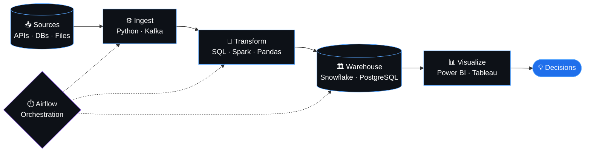

 

 

 

  

 

 

 

  

 

  

 

  

 

 

 

  

  

  

<picture>
  <source media="(prefers-color-scheme: dark)" srcset="https://raw.githubusercontent.com/MohammedAhmed-01/MohammedAhmed-01/output/github-snake-dark.svg" />
  <source media="(prefers-color-scheme: light)" srcset="https://raw.githubusercontent.com/MohammedAhmed-01/MohammedAhmed-01/output/github-snake.svg" />
  
</picture>

  

  

 

  

<i>⚡ "Turning data into insights, one pipeline at a time" ⚡</i>

