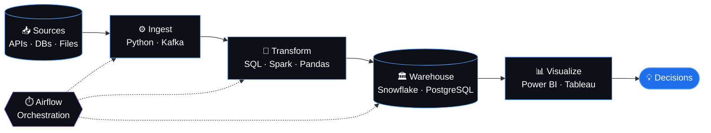

<div align="center">


<a href="https://git.io/typing-svg">
  
</a>

<br/><br/>

<a href="https://www.linkedin.com/in/mohammed-01-salah"></a>
<a href="mailto:mohammedsalahemam01@gmail.com"></a>
<a href="https://github.com/MohammedAhmed-01?tab=repositories"></a>
<a href="https://github.com/MohammedAhmed-01?tab=followers"></a>


<br/><br/>


</div>

<br/>

<!-- ═════════════ ABOUT ═════════════ -->
<div align="center">
  
</div>

<br/>

<table>
<tr>
<td width="60%" valign="top">

I'm a **Data Analyst & Data Engineer** who builds scalable data pipelines, extracts meaningful insights, and turns raw data into decisions. With a strong foundation in **ETL/ELT workflows, SQL, Python, and Power BI**, I bridge the gap between data infrastructure and analytics.

```python
class MohammedSalah:
    role      = "Data Analyst & Data Engineer"
    studying  = "B.Sc. Data Science — HNU (2027)"
    location  = "Egypt 🇪🇬"
    focus     = ["Data Pipelines", "Dashboards", "Analytics Workflows"]
    learning  = ["AWS / GCP / Azure", "Spark", "Airflow", "Kafka"]
    open_to   = ["Data Engineering", "Data Analysis", "Collaboration"]

    def mission(self):
        return "Turning data into decisions 📊"
```

</td>
<td width="40%" align="center" valign="middle">


</td>
</tr>
</table>

<br/>

<!-- ═════════════ WHAT I DO ═════════════ -->
<div align="center">
  
</div>

<br/>

<table>
<tr>
<td width="33%" align="center" valign="top">

### ⚙️ Data Engineering
Designing ETL/ELT pipelines, data models and warehouse-ready datasets that are reliable and scalable.

`Python` `SQL` `Spark` `Airflow`

</td>
<td width="33%" align="center" valign="top">

### 📊 Analytics & BI
Building interactive dashboards, KPI reports and trend analyses that drive business decisions.

`Power BI` `Tableau` `Excel` `Plotly`

</td>
<td width="33%" align="center" valign="top">

### 🤖 Machine Learning
Applying statistical analysis and ML models to uncover patterns and predict outcomes.

`scikit-learn` `Pandas` `TensorFlow` `PyTorch`

</td>
</tr>
</table>

<br/>

<!-- ═════════════ TECH STACK ═════════════ -->
<div align="center">
  
</div>

<br/>

<div align="center">

**🐍 Languages & Databases**


**⚙️ Data Engineering & Big Data**


**☁️ Cloud & Platforms**


**📊 Analysis & Visualization**


**🤖 Machine Learning & AI**


**🛠️ Tools**


</div>

<br/>

<!-- ═════════════ PIPELINE ═════════════ -->
<div align="center">
  
</div>

<br/>



<br/>

<!-- ═════════════ STATS ═════════════ -->
<div align="center">
  
</div>

<br/>

<div align="center">


<br/><br/>


</div>

<br/>

<!-- ═════════════ SNAKE ═════════════ -->
<div align="center">
  

  <br/><br/>

  <picture>
    <source media="(prefers-color-scheme: dark)" srcset="https://raw.githubusercontent.com/MohammedAhmed-01/MohammedAhmed-01/output/github-snake-dark.svg" />
    <source media="(prefers-color-scheme: light)" srcset="https://raw.githubusercontent.com/MohammedAhmed-01/MohammedAhmed-01/output/github-snake.svg" />
    
  </picture>
</div>

<br/>

<!-- ═════════════ CONNECT ═════════════ -->
<div align="center">
  

  <br/><br/>

  

  <br/>

  <a href="https://www.linkedin.com/in/mohammed-01-salah"></a>
  <a href="mailto:mohammedsalahemam01@gmail.com"></a>
  <a href="https://github.com/MohammedAhmed-01?tab=repositories"></a>

  <br/><br/>

  <i>⚡ "Turning data into insights, one pipeline at a time" ⚡</i>
</div>


